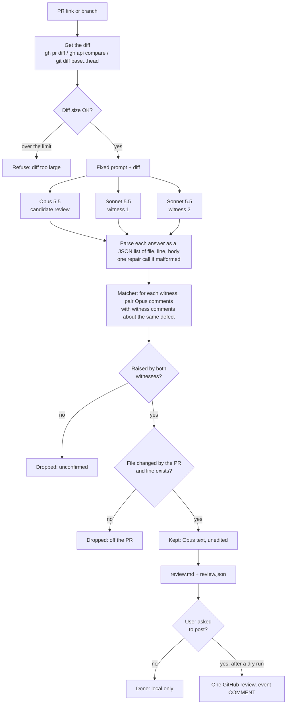
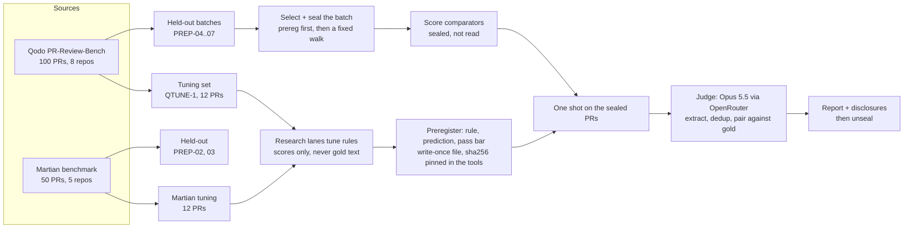
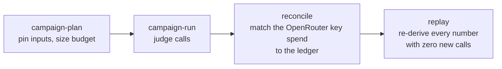
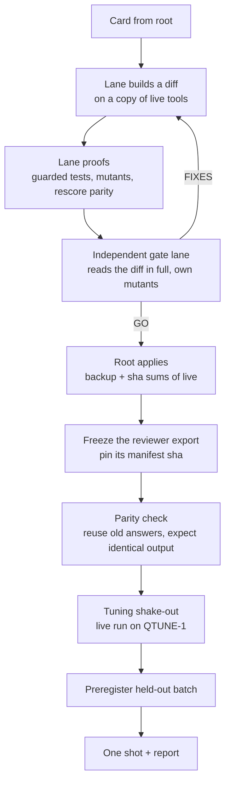

# How Pullo works

This page covers three flows:
1. **The review flow:** how one PR becomes review comments.
2. **The evaluation flow:** how a version is measured against other tools without fooling ourselves.
3. **The change flow:** how a new version gets built and gated.

## 1. The review flow (v26 consensus)

### The three model calls

- They run in parallel. Each is one `claude -p` call: Opus 5.5 for the candidate, Sonnet 5.5 for each witness.
- **Prompt:** the same fixed text for all three, followed by the diff. It asks for the bugs and problems the PR introduces, as a JSON array of `{"file", "line", "body"}` (sha256 `4d63d991…`).
- **Locked down:** no tools (`--tools ""`), no settings (`--setting-sources ""`), no MCP servers, no slash commands, no CLAUDE.md and no session file. Each call runs in an empty work dir.
- **Billing:** they run on the Claude Code subscription. `ANTHROPIC_API_KEY` is never passed.
- **Failures:** each call gets one repair if its answer is not a valid JSON array, and one retry if the CLI fails.

### The matcher (`res2-lexical-1to1@1`)

It is deterministic, with no model call. Two comments describe the same defect when they are in the **same file** and either:
- they are within 3 lines and share a little vocabulary (word overlap ≥ .06 or code-identifier overlap ≥ .34), or
- they are within 15 lines and share more (≥ .18 or ≥ .5), or
- they are anywhere in the file and clearly tell the same story (word overlap ≥ .30 and code overlap ≥ .5).

Pairs are chosen greedily by score, one-to-one per witness. An Opus comment's **votes** is the number of witnesses that matched it. It is kept when votes ≥ k; in v26, k = 2 of n = 2.

### Why a vote, and not a verifier?

Measured on the 12 QTUNE-1 tuning PRs (39 gold issues):

| Arm | F1 | Gold found | False positives |
|---|---:|---:|---:|
| Plain Opus, every comment | .639 | 31 | 27 |
| Plain Opus, kept if 1 Sonnet witness agrees (E3) | .707 | 29 | 14 |
| v26 live: 2 fresh witnesses, 2 of 2 | .654 | 27 | 16 |
| v24: Opus candidates + the staged VERIFY/JUDGE | .495 | 16 | 9 |
| Greptile (historical) | .611 | 19 | 4 |
| CodeRabbit (historical) | .582 | 21 | 11 |

- **Opus alone** finds most issues but raises many false alarms.
- **A model verifier** (v24) threw away true issues along with the false ones.
- **The vote** keeps most of the true ones, because two independent reviews rarely invent the same false alarm.
- **2 of 2 instead of 1 witness:** one witness was unstable across resamples (F1 spread .057), so v26 uses two.

## 2. The evaluation flow

### Rules that keep the numbers honest

- **Tuning and held-out never mix.** Rules are chosen on tuning PRs only. Held-out PR names, gold text and comparator text stay out of development contexts.
- **Preregistration first.** Before a held-out run, a write-once file fixes the version (its export sha), the arm, the cases, the attempt rule, the judge and the pass rule. The tools refuse to run until that file's sha256 is pinned in them.
- **One shot per version per batch.** A retry is allowed only after an attempt that settled without completing (for example, a provider outage). A PR whose review could not run scores as an **empty review**: 0 found, all its gold still counted as missed.
- **Comparators first, sealed.** CodeRabbit and Greptile reviews of the same PRs are scored before the one shot and not read until after.
- **A common judge.** Every tool is scored by the same judge. The judge's export is frozen and pinned. The judge's prompts, schema and matcher are identical across versions. A successor version may change only budget constants or receipt accounting, and that is proven file by file on every load.

### Scoring (the private benchmark harness)

Each campaign moves through four steps:

- **Judge steps:** extract turns each review into candidate issues, dedup groups repeats, and pair matches each group against each gold issue.
- **Metrics:** `native-graph@1`, a TP is a matched group and recall counts distinct gold recalled. There are three profiles: strict, core (the report table) and all. Each prereg names its headline; for PREP-06 it was all.
- **Report:** the campaigns are combined into one report, with one tool per case and every disclosure.

## 3. The change flow

- Authors never approve their own gate.
- Every test or mutation run is **guarded**: a masked HOME, a fake CLI, no network, and an mtime check on the evidence and operator state directories. One unguarded mutation run once escaped and made 12 real calls. Those runs are listed in a registry and can never be scored or reused.
- Details: [DEVELOPERS.md](DEVELOPERS.md).
