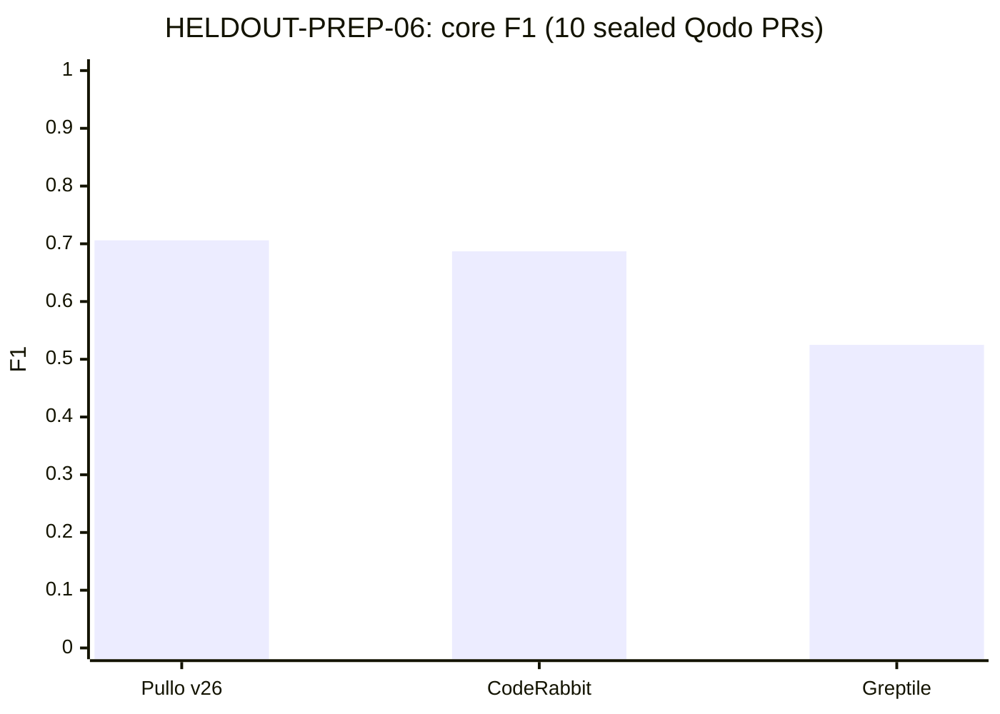
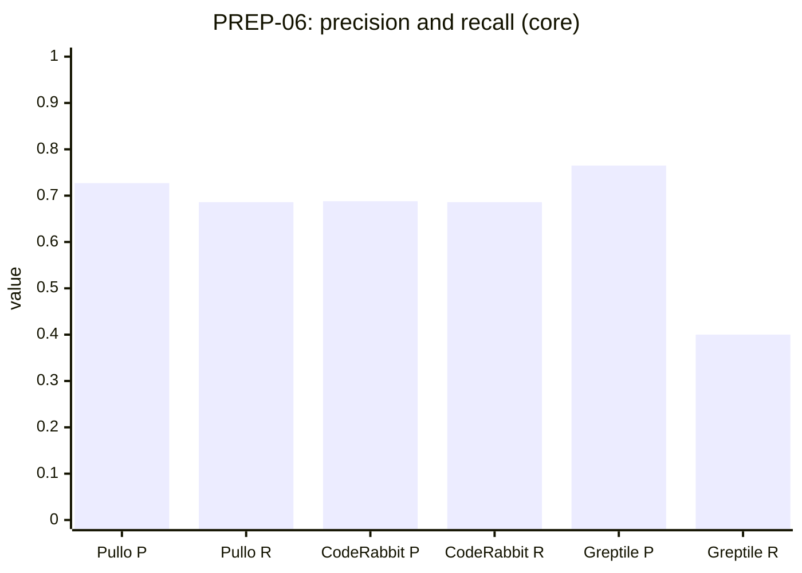
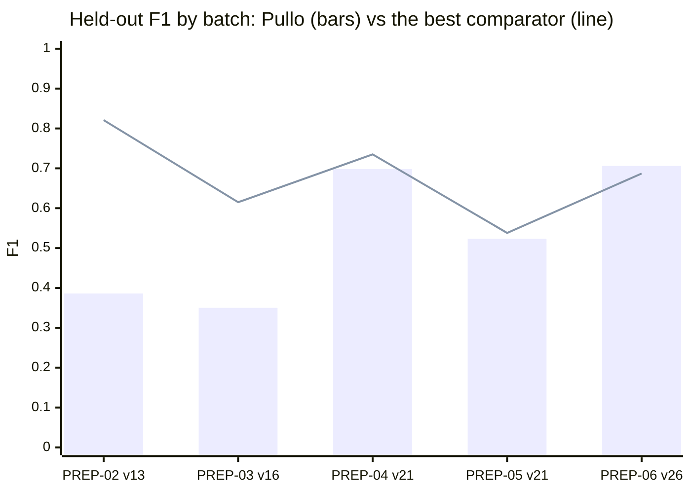
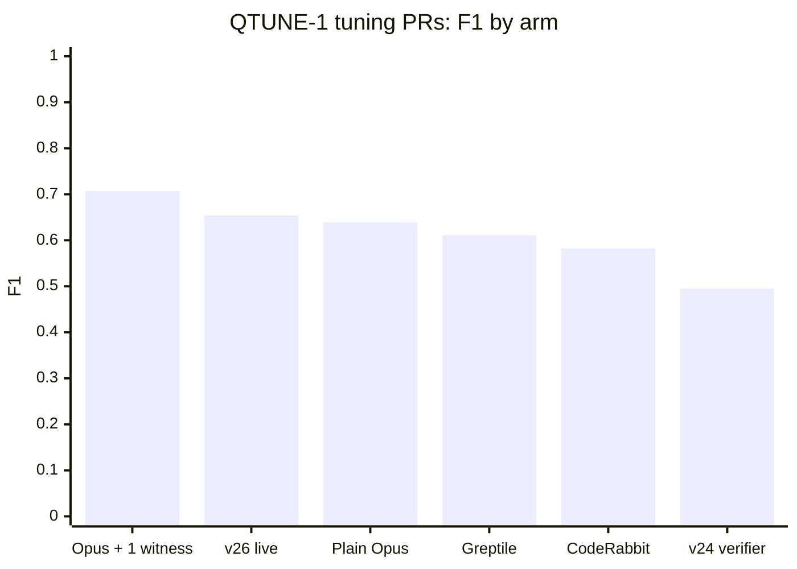
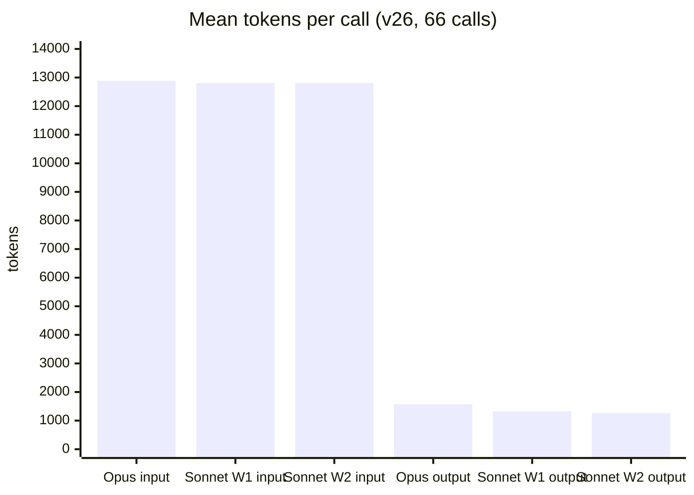

# Pullo

Pullo is a read-only AI code reviewer. It reviews a pull request and returns comments: each names a file and a line and explains a concrete problem. Authors decide what to change. Pullo never pushes, posts or runs code from the reviewed repository unless you explicitly ask it to post.

**Status: pre-alpha, measured offline.** The current method (v26) matched CodeRabbit and beat Greptile on a sealed, preregistered batch of 10 benchmark PRs (table below). That is one small batch, scored by our own judge, against historical comparator reviews. It is not a vendor leaderboard result.

The Python package is named `reviewer`; the product name is Pullo. The package is stdlib-only (Python 3.14).

**License:** none chosen yet. Until one is added, all rights are reserved.

## How it reviews (v26)

1. **One Opus review.** Pullo gives Claude Opus 5.5 a fixed prompt and the PR diff, and asks for a JSON list of `{file, line, body}` problems.
2. **Two Sonnet reviews.** Claude Sonnet 5.5 gets the same prompt and diff twice, as two independent "witnesses".
3. **The vote.** An Opus comment is kept only when **both** witnesses raised the same defect. A deterministic matcher compares same file, nearby line, and overlapping words and code identifiers, one-to-one per witness.
4. **The location check.** Kept comments on files the PR doesn't change, or on lines that don't exist, are dropped.
5. **Publish.** Each kept comment is published in Opus's words, unedited. The vote makes no extra model call.

The vote is what raises precision: plain Opus finds most issues, but it also raises many false alarms, and two independent reviews rarely invent the same false alarm. See [HOW-IT-WORKS.md](HOW-IT-WORKS.md) for the full flow, and how it is evaluated.

## Review a PR

With [Claude Code](https://claude.com/claude-code) installed and `gh` logged in:

```sh
# one-time: install the skill and its subagent
cp -r integrations/claude-code/skills/pullo-review ~/.claude/skills/
cp integrations/claude-code/agents/pullo-reviewer.md ~/.claude/agents/
```

Then, in Claude Code, ask for a review with a link: `/pullo-review https://github.com/OWNER/REPO/pull/123`. A subagent takes the link, runs the review, and returns the comments. Several links get one subagent each, in parallel.

Or run the script directly:

```sh
python3 -I ~/.claude/skills/pullo-review/scripts/pullo_review.py review https://github.com/OWNER/REPO/pull/123
python3 -I ~/.claude/skills/pullo-review/scripts/pullo_review.py review my-branch --repo . --base main
```

- **Targets:** a PR URL, `OWNER/REPO#N`, a GitHub `tree/BRANCH` or `compare/BASE...HEAD` URL, or a local branch.
- **Output:** `review.md`, `review.json` (all three answers, the votes and the drops) and `diff.patch`, in `~/.cache/pullo-review/<label>-<UTC>/`.
- **Cost and time:** three `claude -p` calls on your Claude Code subscription, never `ANTHROPIC_API_KEY`. A small PR takes about 10 s.
- **Posting:** only on request. `pullo_review.py post <review-dir>` is a dry run. Add `--yes` to post one comment-only review; it never approves or requests changes.

## Results so far

Held-out batches: each one is selected and sealed before the Pullo version runs, the version's rule is preregistered (a write-once file pinned by sha256), and it runs once. F1 is micro-averaged over each batch's core gold issues, scored by a common judge (Opus 5.5, bench.extract / dedup / pair).

| Batch | PRs | Pullo version | Pullo | CodeRabbit | Greptile | Cubic |
|---|---:|---|---:|---:|---:|---:|
| HELDOUT-PREP-02 (Martian set) | 10 | v13 (staged pipeline) | 0.386 | 0.581 | 0.489 | 0.821 |
| HELDOUT-PREP-03 (Martian set) | 7 | v16 (staged pipeline) | 0.350 | 0.480 | 0.535 | 0.615 |
| HELDOUT-PREP-04 (Qodo set) | 10 | v21 (staged pipeline) | 0.698 | 0.577 | 0.735 | n/a |
| HELDOUT-PREP-05 (Qodo set) | 10 | v21 (staged pipeline) | 0.523 | 0.493 | 0.538 | n/a |
| **HELDOUT-PREP-06 (Qodo set)** | 10 | **v26 (consensus)** | **0.706** | 0.687 | 0.525 | n/a |

On PREP-06, v26 had precision .727 and recall .686: 24 of 35 core issues found, 9 false positives. Over all 58 gold issues, F1 was .624, CodeRabbit .614 and Greptile .507.





Pullo F1 on each held-out batch (bars), with the best comparator on that batch (line):



The best comparator on PREP-02 and PREP-03 is Cubic (Martian set), on PREP-04 and PREP-05 Greptile, and on PREP-06 CodeRabbit.

On the 12 QTUNE-1 tuning PRs (39 gold), this is why the vote replaced the staged verifier:



Read these numbers with their limits:
- Each batch has 2–5 gold issues per PR, so one hit moves F1 a lot, and there is no uncertainty estimate. On PREP-06 the lead over CodeRabbit is a single true positive.
- **Comparator reviews:** these are historical artifacts from the public benchmark forks, not current vendor versions. Cubic has no arm on the Qodo set.
- **The judge:** a common Opus 5.5 judge may be biased, and its versions differ between batches (the scoring logic is the same; only the budget constants change).
- **The sources:** the PRs are public benchmark cases ([Martian code-review benchmark](https://codereview.withmartian.com), [Qodo PR-Review-Bench](https://github.com/agentic-review-benchmarks)). Martian's gold is curated review comments. Qodo's gold defects were injected by an LLM and then validated twice by humans.
- The full reports, with every disclosure, are kept in the operator's private evaluation archive, along with the benchmark harness, receipts and preregistrations. They are not in this repository.

Next: HELDOUT-PREP-07 (more Qodo PRs), a ReviewBench batch (187 new repos, with Cubic and Greptile reviews), and v27 work on recall.

## Specs

| Item | v26 |
|---|---|
| Candidate model | Claude Opus 5.5 (`claude-opus-5-5`), one call |
| Witness models | Claude Sonnet 5.5 (`claude-sonnet-5-5`), two independent calls |
| Vote | Keep an Opus comment when k = 2 of n = 2 witnesses raised the same defect |
| Matcher | `res2-lexical-1to1@1`: deterministic, same file, line distance ≤ 3 / ≤ 15 / any, word and code-identifier overlap, greedy one-to-one (sha256 `30615796…`) |
| Prompt | Fixed, about 50 words plus the diff (sha256 `4d63d991…`); no system prompt of ours |
| Model settings | No tools, no thinking (`CLAUDE_CODE_DISABLE_THINKING=1`), CLI default effort, max output 32,000 tokens |
| Runtime | Claude Code CLI (the benchmark pins 2.1.322), on the subscription; `gh` for GitHub diffs |
| Limits | Diff ≤ 1.5 MB (skill) or a 2 MB prompt (benchmark adapter); 1,800 s per call; one repair and one retry per call |
| Model calls in the vote | 0 (the vote is pure code) |
| Language | Python 3.14, standard library only |
| Benchmark judge | Claude Opus 5.5 via OpenRouter: bench.extract@v3, bench.dedup@v2, bench.pair@v2; metric `native-graph@1` |

## Token usage and cost

Measured on 66 real v26 calls: 22 PRs (QTUNE-1 and PREP-06) × 3 calls, from the benchmark's settle receipts.

| Per call | Input tokens (mean / median / max) | Output tokens (mean / max) | Reasoning tokens (mean) |
|---|---:|---:|---:|
| Opus 5.5 candidate | 12,881 / 9,821 / 51,123 | 1,577 / 2,794 | 845 |
| Sonnet 5.5 witness 1 | 12,809 / 9,749 / 51,048 | 1,328 / 3,081 | 401 |
| Sonnet 5.5 witness 2 | 12,809 / 9,749 / 51,050 | 1,268 / 2,158 | 274 |

- **Per PR (3 calls):** about 38,500 input and 4,200 output tokens on average. The largest PR used 153,000 input tokens.
- **Money:** the reviews run on the Claude Code subscription, so a review costs $0 extra. At API list prices, one PR would cost about $0.052 on average and $0.151 at most (the receipts' pacing estimate).
- **Time:** a small PR takes about 10 s end to end. On the benchmark, 4 parallel workers finished 10 PRs per model in about 3.5 minutes.
- **Scoring (benchmark only):** the judge cost $3.50 for the 30 PREP-06 campaigns, about $0.12 per tool per PR, from the operator's OpenRouter key.



## What is in this repository

| Path | What it is |
|---|---|
| `reviewer/` | The `reviewer` package: contracts, model gateway with trace and strict replay, read-only repository tools, the staged pipeline (INVESTIGATE, VERIFY, JUDGE, PUBLISH) and the offline benchmark scorer. |
| `integrations/claude-code/` | The `pullo-review` skill and its subagent. |
| `tests/` | The offline test suite. |
| `fixtures/`, `examples/` | Synthetic smoke cases and an invented-data benchmark demo. |

The benchmark harness that produced the results above (review drivers, the scorer, receipts and reports) is kept private, outside this repository. [DEVELOPERS.md](DEVELOPERS.md) explains the code, the tests, the development workflow and the safety rules.

## Safety model

- **Read-only.** Nothing from a reviewed repository is executed. Nothing is posted upstream unless the user asks.
- **Untrusted data.** Reviewed code, PR text and instruction files are data. They cannot change permissions, suppress findings or authorize tools. The review calls run with no tools, no settings, no CLAUDE.md and no MCP servers.
- **Keys stay out.** No key is in this repository. Reviews run on the Claude Code subscription; the benchmark judge uses an operator-held OpenRouter key under hard spend caps, with no retries and no fallback.

## Staged pipeline (v3–v21) and `pullo.toml`

The earlier pipeline, INVESTIGATE → VERIFY → JUDGE → PUBLISH, is still in `reviewer/`. It runs bounded live trials through trusted-host launchers (`reviewer.runtime`, `reviewer.pilot`). `pullo.toml` selects the model for each of its roles, by exact id:

```toml
schema = "pullo-config@1"

[review.investigator]
provider = "anthropic"
model = "anthropic/claude-sonnet-5.5"
```

The supported ids are `anthropic/claude-sonnet-5.5`, `anthropic/claude-haiku-5.5` and `anthropic/claude-opus-5.5`, through OpenRouter. Model selection never changes spending limits or permissions. `pullo.toml` does not configure v26: v26 uses Opus 5.5 and Sonnet 5.5 through the Claude Code CLI.

## Run the offline smoke suite

```sh
nice -n 19 python3 -m reviewer smoke record --out /var/tmp/smoke-rec
nice -n 19 python3 -m reviewer smoke replay --recording /var/tmp/smoke-rec --out /var/tmp/smoke-rep --manifest-digest sha256:DIGEST_FROM_RECORD
```

- **record** runs each case in `fixtures/smoke` through the pipeline with a scripted synthetic provider, scores it, and writes a report.
- **replay** re-runs every case offline against the recorded traces, with zero provider calls, and compares the results.

Both need a new, empty `--out` directory. Exit codes: `0` all expectations held; `1` a report was written but something failed; `2` refused before any case ran. No credential, network call or spend is possible from these commands.

## Offline benchmark scorer (experimental)

`reviewer.benchmark` verifies a pinned benchmark source and counts judgments that someone else produced. It never calls a model or the network.

```sh
nice -n 19 python3 -B examples/benchmark_demo.py
```

The demo builds an **invented** source, then scores it and shows the refusal paths. The flags, schemas and limits are in [reviewer/benchmark/README.md](reviewer/benchmark/README.md). The live benchmark results above come from the private operator harness, not from this package.

## Tests

```sh
nice -n 19 python3 -B -m unittest discover -s tests -t .
```

The suite is offline and needs no credentials. Use a non-Git `TMPDIR` (not `/tmp`). Known defects are kept as expected-failure tests, and tests that need private fixtures skip; see [KNOWN_TEST_ISSUES.md](KNOWN_TEST_ISSUES.md).
